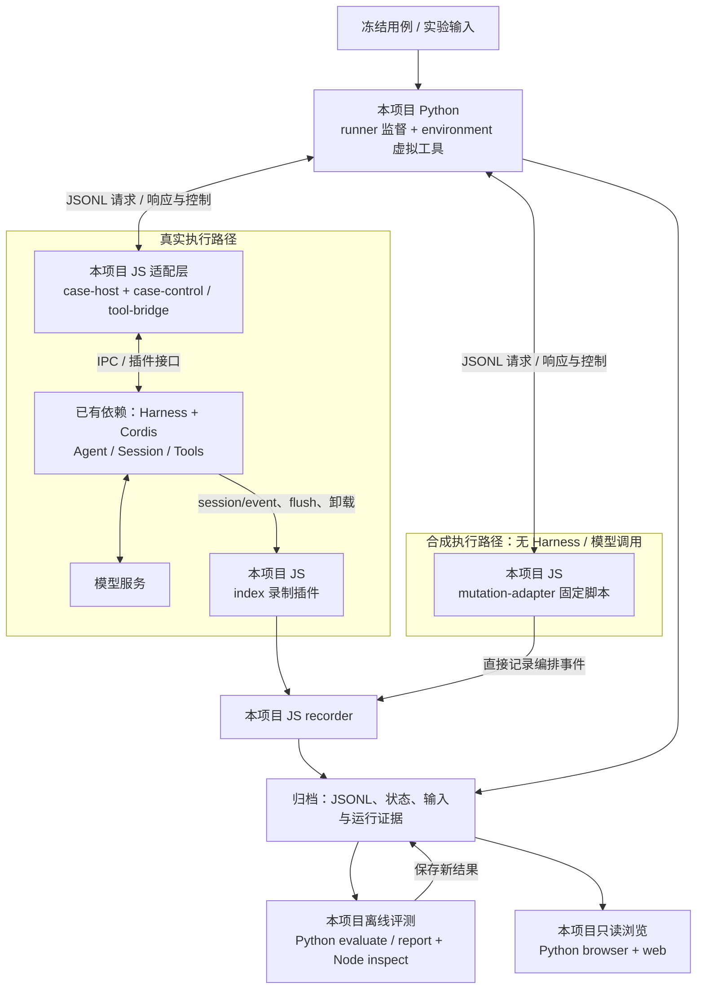

# 设计概览：从执行事实到可核对结论

dsh-eval-lab 为 DeepSeek Harness 增加轨迹记录、受控任务执行、离线断言和结果浏览。Harness 的 Agent 循环、Session、Tools 与 Cordis 插件系统是已有依赖；本项目实现接入这些组件的 JavaScript 插件与适配器，以及 Python 监督、状态化工具环境和评测层。详细协议见[架构说明](architecture.md)，当前验证范围见[进度](progress.md)与[能力矩阵](capabilities.md)。

## 组件与数据流

图中的适配层横跨两个 Node 进程：`case-host.js` 启动专用 Harness 子进程并转发消息，`case-control.js` 与 `tool-bridge.js` 在该子进程内注册工具、等待结果并处理取消。Python 持有虚拟文件状态和工具期限，模型通过已注册的工具接口收到结果。录制插件监听 Session 事件，不实现 Agent 决策。

合成路径由 [workflow_demo.py](../dsh_eval/workflow_demo.py) 选择 `run_synthetic_case()`，预先固定脚本与回复，再通过 [mutation-adapter.js](../scripts/fixtures/mutation-adapter.js) 产生事件。它复用真实管道、Python 环境、recorder、inspect 和评测器，但绕过 Harness 安装及模型；evidence.json保存`source=synthetic`，synthetic.json和runtime.json另保存`modelCalled=false`，工作流索引也声明无模型调用。不能把两条路径的结果合并为模型表现数据。

| 部分 | 本项目职责与源码入口 |
| --- | --- |
| JS 插件与记录器 | [index.js](../src/index.js) 接入 Cordis 事件、flush 与卸载；[recorder.js](../src/recorder.js) 管理会话写入队列、容量、检查点和封存；[inspect.js](../src/inspect.js) 只读核对字节、序号、身份与状态 |
| JS 宿主适配与工具桥 | [case-host.js](../scripts/case-host.js) 准备隔离 profile、启动专用子进程、观察路由和退出；[case-control.js](../scripts/fixtures/case-control.js) 注册控制插件；[tool-bridge.js](../scripts/lib/tool-bridge.js) 注册工具并关联请求、响应及取消 |
| Python 执行与工具状态 | [runner.py](../dsh_eval/runner.py) 冻结单任务输入、监督进程和期限、保存运行事实；[environment.py](../dsh_eval/environment.py) 实现虚拟文件操作、工具超时与最终快照 |
| Python 调度与续跑 | [experiment.py](../dsh_eval/experiment.py)、[batch.py](../dsh_eval/batch.py) 展开并冻结计划；[resume.py](../dsh_eval/resume.py) 与[实验续跑入口](../dsh_eval/experiment_resume.py) 复核明确绑定的源证据，只领取未开始项 |
| Python 离线评测与报告 | [evaluate.py](../dsh_eval/evaluate.py) 重新运行 Node inspect，核对单任务身份、实际配置与断言；[report.py](../dsh_eval/report.py) 复验冻结样本、保留保存值并生成新报告 |
| 只读浏览 | [browser.py](../dsh_eval/browser.py) 限制根目录、路径和事件身份；[web 界面](../dsh_eval/web/app.js) 展示保存结论与原始事件，不启动执行或重新评分 |

## 用一次改名重试串起职责

[rename-timeout-retry 用例](../fixtures/evaluation/rename-timeout-retry.case.json) 的初态是 `draft.txt` 内容为 `评测\r\n`，`guard.txt` 内容为 `keep\n`。目标是移到 `archive/final.txt`，保留 guard，并按规定顺序确认超时没有产生改动。

1. **准备与监督。** Python 保存用例快照并创建状态环境。真实路径启动 Harness；合成路径启动固定适配器。首次 `eval_rename` 预设延迟 1500 ms，该工具期限为 1000 ms。
2. **工具结果。** 工具请求经 JSONL / IPC 桥到 Python。期限到达后，环境返回 `TOOL_TIMEOUT`，该请求不会提交改名；它不是让模型等待 1500 ms 后再补发成功。
3. **执行行为。** 完整步骤应依次为：首次改名超时 → 读取源并确认原文 → 读取目标并观察 `NOT_FOUND` → 使用新请求重试改名 → 读取目标验证原文。真实路径由模型决定是否遵循这些要求；合成路径的调用顺序预先编排。
4. **记录与收尾。** 真实路径通过插件记录Session产生的调用、结果和最终回复，合成路径由适配器直接记录同结构事件；收尾排空recorder队列并封存。Python另存退出、干预、实际路由和带身份的最终环境快照。
5. **离线判定。** `evaluate()` 先 fresh inspect，再关联 `caseRunId / runId / sessionId`、配置与快照。工具结果断言的 `after` 要求后继 `callSeq` 大于前置 `resultSeq`；最终文件正确不能替代中间读回证据。

三层结论各回答一个问题：`execution.status=completed` 表示执行正常结束；`recording.outcome=complete` 表示所录片段通过完整性检查；任务 `outcome=passed` 还要求必需断言全部通过。任一项都不能代替另外两项。

这里有两组独立依据：[117 真实四任务验收](changes/2026-11-04-117-live-confirmation-matrix.md)记录了真实模型的完整五步链；[121 合成漏步反例](changes/2026-11-09-121-rename-skip-readbacks.md)则保留了正确最终文件和回复，却省略两次中间读取。后者执行 completed、录制 complete，但十条断言中六项通过、四项缺证，任务为 unevaluable。[124 结构化诊断](changes/2026-11-09-124-structured-assertion-diagnostics.md)进一步把首个缺证与三个后继阻断分开，同时保留实际成功 retry / verify 的观察位置。

## 五项关键取舍

| 取舍 | 解决的问题 | 代价与边界 |
| --- | --- | --- |
| JS 接入与 Python 分析通过版本化文件 / IPC 连接 | 保留 Harness / Cordis 原生插件与实时工具接口；用同一 Python 环境和评测器服务执行、合成检查及离线复验 | 要维护协议、身份、子进程与管道清理；超时控制帧不能插入半条 JSONL，清理宽限与任务期限分开。[桥接设计](stateful-tools.md)、[管道阻塞修正](changes/2026-10-18-014-m3-3-review-fixes.md) |
| 执行、录制、断言分层 | 区分“宿主结束”“证据可用”“行为满足要求”，避免把进程退出 0 当作任务成功 | 需要多个状态和证据不足分支；日志完整仍可能任务失败或不可评。[评测格式](evaluation-format.md) |
| 冻结输入，续跑依赖显式绑定、指纹、锁与领取记录 | 让报告可核对当时任务与规则，防止重复执行或将别批证据误接入；仅为可证明未开始的项创建新执行 | 未知执行或清理事实会阻断续跑；崩溃留下的领取不能自动回收。续跑不恢复模型上下文，也不是重放。[批次续跑](batch-resume.md)、[实验续跑](experiment-resume.md) |
| 浏览只读，并校验路径与运行身份 | 保存结论可跳到指定原始事件；避免打开错误运行的同一序号，以及访问配置根目录外文件 | 浏览不会自动修复、重评或执行；超出预览限制或证据缺失时只能显示不可用。定位一行不等于重新验证整份录制。[浏览实现](../dsh_eval/browser.py)、[浏览说明](result-browser.md) |
| 先验证证据，再评分；规则变化写新结果 | 先复验录制、身份、冻结输入和实际路由，再解释行为差异；保留原文、旧结论和诊断角色，避免事后放宽规则覆盖失败 | 缺证不能算作成功；离线复验有额外 I/O 和进程开销。新规则的结论只属于该规则下的新报告，不能改写原验收。[报告](configuration-reports.md)、[规则预览](evaluation-format.md) |

记录器只捕获启用后观察到的新增事件片段。`record()` 成功表示入队；`flush()` 等待选定检查点的写入，不承诺 fsync 或断电可靠。摘要用于一致性核对，不是签名。受控样本与合成反例证明各自限定范围内的行为和工具链，不证明模型总体稳定性或泛化能力。

## 阅读与复现入口

可从[离线工作流演示](workflow-demo.md)生成完整步骤、漏步和同轨迹规则变化三个场景，再沿评测中的证据位置查看调用与结果。需要了解运行协议时继续阅读[状态化工具](stateful-tools.md)和[评测格式](evaluation-format.md)；需要核对交付范围时查看[能力矩阵](capabilities.md)与对应修改记录。以上真实历史结果与合成演示保持独立，本页不新增运行或验证结论。
